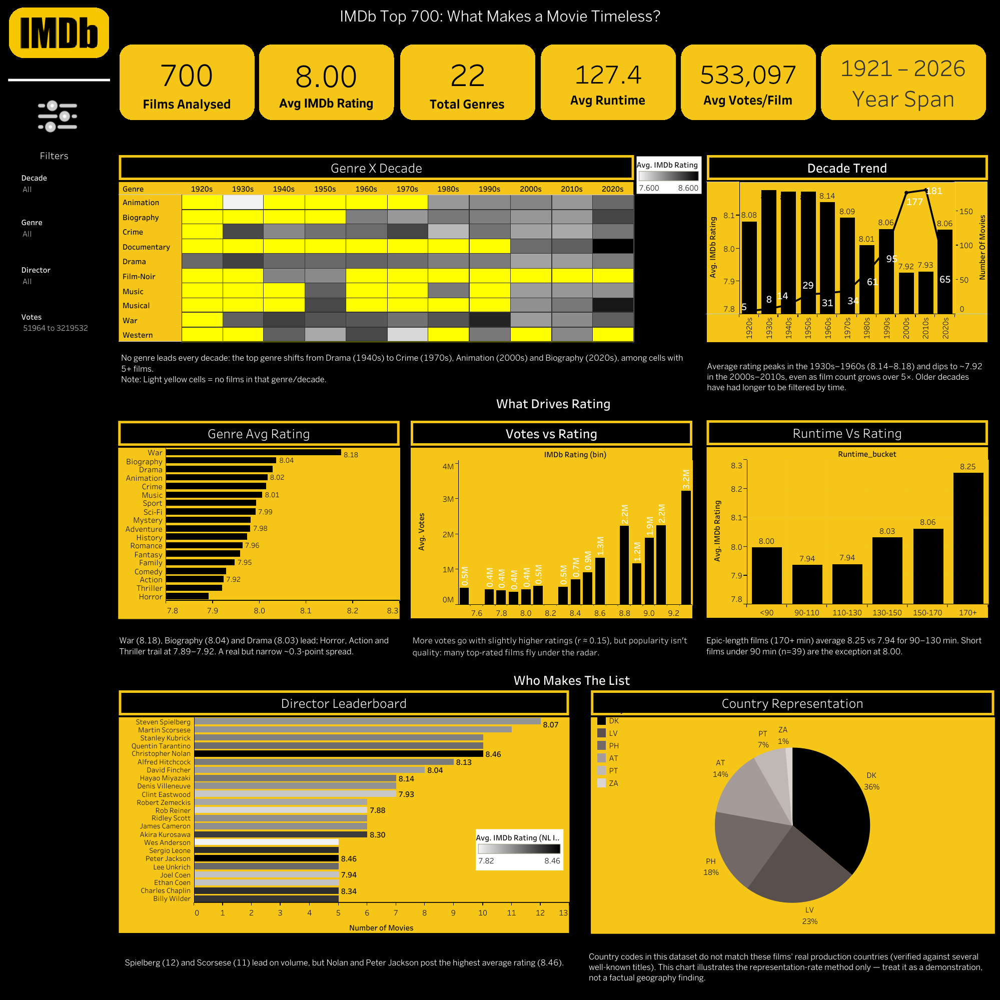

# 🎬 IMDb Top 700: Decoding What Makes a Movie Timeless

> An end-to-end exploratory and statistical analysis of IMDb's Top 700 films, covering what drives a high Bayesian-weighted rating across genre, era, director, country, votes and runtime.



---

## 📌 Table of Contents
- [Business Problem](#-business-problem)
- [Key Metric & Supporting KPIs](#-key-metric--supporting-kpis)
- [Dataset](#-dataset)
- [Approach](#-approach)
- [Hypotheses & Results](#-hypotheses--results)
- [Key Findings](#-key-findings)
- [Recommendations](#-recommendations)
- [Data Quality Caveat](#%EF%B8%8F-data-quality-caveat)
- [Tableau Dashboard](#-tableau-dashboard)
- [Repository Structure](#-repository-structure)
- [How to Run](#-how-to-run)
- [Tech Stack](#-tech-stack)

---

## 🎯 Business Problem

IMDb's Top 250 uses a Bayesian-weighted average rather than a raw score, which makes it one of the most referenced quality signals in the film industry. Extended to a **Top 700**, the Content Insights team wants to go beyond a ranked list and understand **why** certain films earn this distinction, across genres, eras, directors and countries.

The findings are meant to inform **curation, "hidden gem" surfacing, and editorial storytelling** around the Top 700.

## 📏 Key Metric & Supporting KPIs

**Average IMDb Rating** = mean IMDb Rating within a segment (genre, decade, director or country).

| Supporting KPI | What it shows |
|---|---|
| Average Votes per Film (by genre / decade) | Whether high ratings are backed by broad consensus or a concentrated fanbase |
| Director Frequency in Top 700 | Which directors consistently produce Top 700-caliber work |
| Country Representation Rate | Which regions are over- or under-represented |

## 🗂️ Dataset

`IMDb_Top_700_Movies_2026.csv`: **700 films, 10 fields**

| Column | Description |
|---|---|
| Rank | Position on the list |
| Title | Movie name |
| Year | Release year (1921 to 2026) |
| Genre(s) | Primary and secondary genres (pipe-delimited) |
| Director | Film director |
| Main Actor(s) | Leading actors |
| Country | Origin country code(s) (pipe-delimited) |
| IMDb Rating | Bayesian-weighted rating out of 10 |
| Votes | Number of IMDb user votes |
| Runtime (mins) | Duration in minutes |

Multi-value fields (Genre, Director, Country) were exploded into long format, available in `data/`.

## 🔬 Approach

1. **Data quality checks:** types, missing values, duplicates, outliers
2. **Cleaning & feature engineering:** decade labels, runtime buckets, log10(Votes), exploded genre/director/country tables
3. **Hypothesis definition:** 6 testable hypotheses
4. **EDA:** univariate and bivariate/multivariate analysis
5. **Statistical testing:** Pearson correlation, one-way ANOVA, Welch's t-test
6. **Dashboard:** interactive Tableau storyboard with filters
7. **Insights & recommendations** for the Content Insights team

**Data handling decisions**
- Only `Main Actor(s)` had nulls (10 rows, 1.4%). All are documentaries with no single lead, so they were labelled rather than dropped.
- No duplicate records.
- Vote and runtime outliers are legitimate extreme values (blockbusters, 300+ minute epics), so they were kept. A log10 transform was applied to Votes.

## 🧪 Hypotheses & Results

| # | Hypothesis | Test | Result |
|---|---|---|---|
| H1 | More votes associate with higher rating | Pearson: Rating vs log10(Votes) | ✅ Supported (r ≈ 0.15, weak) |
| H2 | Average rating differs across genres | One-way ANOVA (genres with n ≥ 15) | ✅ Supported (F ≈ 2.61, p < 0.001) |
| H3 | Prolific directors (4+ films) average higher ratings | Welch's t-test | ✅ Supported (8.07 vs 7.97, p < 0.001) |
| H4 | Longer runtime associates with higher rating | Pearson: Rating vs Runtime | ✅ Supported (r ≈ 0.24) |
| H5 | Older films average higher ratings | Pearson: Rating vs Year + decade means | ✅ Supported (r ≈ -0.20) |
| H6 | Older films have more votes (votes do not rise linearly with age) | Decade-level means, Votes vs Decade | ❌ Rejected (votes peak in the 1990s, ~702K per film, vs ~141K for the 1920s) |

## 💡 Key Findings

- **Genre matters, modestly.** War (8.18), Biography (8.04) and Drama (8.03) lead. Horror, Action and Thriller trail (7.89 to 7.92). The difference is significant but the spread is only about 0.3 points.
- **Time is the great filter.** The 1930s to 1960s average about 8.15 to 8.18. The 2000s and 2010s dip to about 7.92, even as the number of qualifying films grows 5×. This is consistent with a survivorship/nostalgia effect.
- **Popularity ≠ quality.** Votes and rating correlate only weakly, which leaves room for "hidden gems".
- **Runtime effect is likely genre-confounded.** Films over 170 minutes average 8.26 vs 7.94 for 90 to 110 minutes, but prestige genres (War, Biography, epic Drama) are disproportionately long.
- **Director track record is a real signal.** Spielberg (12 films) and Scorsese (11) lead on volume, while Christopher Nolan and Peter Jackson lead on average rating (8.46).
- **No genre dominates every era.** The top genre shifts across decades, so genre and era should be considered together.

## ✅ Recommendations

1. **Surface hidden gems:** prioritise films with above-median rating but below-median votes.
2. **Era-aware framing:** present 2000s/2010s titles as "modern classics still being tested by time".
3. **Dual director storytelling:** build both "most consistently present" (Spielberg, Scorsese) and "highest peak quality" (Nolan, Jackson) collections.
4. **Genre-and-era pairing:** use the Genre × Decade view instead of blanket genre rules.
5. **Data governance:** re-source the Country field before using regional findings externally.

## ⚠️ Data Quality Caveat

Country codes in this dataset (e.g. `DK`, `AT`, `LV`) **do not match the real-world production countries** of the films. For example, *The Shawshank Redemption* is tagged `DK|AT`. The field appears to have been shuffled or anonymised. The country analysis and chart are therefore a **demonstration of the representation-rate method**, not a factual finding about global cinema.

## 📊 Tableau Dashboard

An interactive dashboard with KPI tiles, filters (Decade, Genre, Director, Votes) and a storyboard flow:

- **Overview:** films analysed, avg rating, total genres, avg runtime, avg votes, year span
- **Genre × Decade heatmap** and **Decade trend**
- **What drives rating:** Genre avg rating, Votes vs Rating, Runtime vs Rating
- **Who makes the list:** Director leaderboard, Country representation

📎 Workbook: [`Dashboards\imdb_dashboard.twb`](Dashboards\imdb_dashboard.twb)
🌐 Live version: *[https://public.tableau.com/views/imdb_dashboard_17914104056130/IMDbTop700Overview?:language=en-US&publish=yes&:sid=&:redirect=auth&:display_count=n&:origin=viz_share_link]*

> To open the workbook, re-point the data source to `Data\IMDb_Top_700_Movies_2026.csv` if Tableau asks for it.

## 📁 Repository Structure

```
imdb-top-700-analysis/
├── README.md
├── notebooks/
│   └── NL_IMDbTop700.ipynb
├── data/
│   ├── IMDb_Top_700_Movies_2026.csv
│   ├── NL_IMDbTop700_genre_long.csv
│   ├── NL_IMDbTop700_director_long.csv
│   └── NL_IMDbTop700_country_long.csv
├── dashboard/
│   ├── imdb_dashboard.twb
│   └── IMDb_Top_700___Overview.png
└── report/
    └── NL_IMDbTop700.pdf
```

## ▶️ How to Run

```bash
# 1. Clone the repo
git clone https://github.com/kanika39/IMDb-Movies-Analysis.git
cd imdb-top-700-analysis

# 2. Install dependencies
pip install pandas numpy scipy matplotlib seaborn jupyter

# 3. Launch the notebook
jupyter notebook Notebooks\NL_IMDbTop700.ipynb
```

The notebook was built on Google Colab. If you run it locally, make sure the CSV path points to `Data/IMDb_Top_700_Movies_2026.csv`.

## 🛠️ Tech Stack

- **Python:** pandas, NumPy, SciPy, Matplotlib, Seaborn
- **Statistics:** Pearson correlation, one-way ANOVA, Welch's t-test
- **BI:** Tableau
- **Environment:** Google Colab / Jupyter

## 📄 Full Report

A 12-page report covering context, methodology, hypotheses, findings and recommendations is in [`report/NL_IMDbTop700.pdf`](Reports\NL_IMDbTop700.pdf).

---

⭐ If you found this useful, consider starring the repo. Feedback is welcome!
